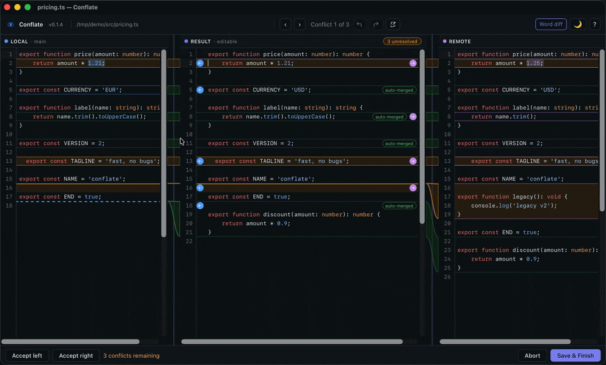
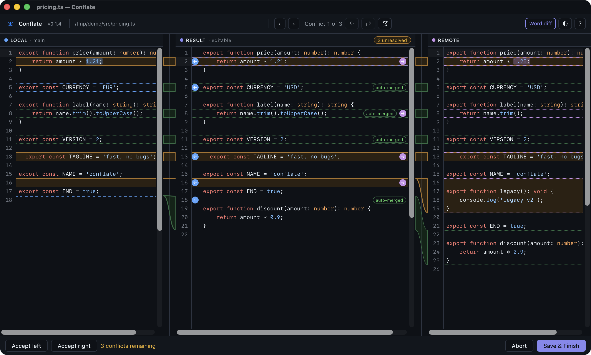
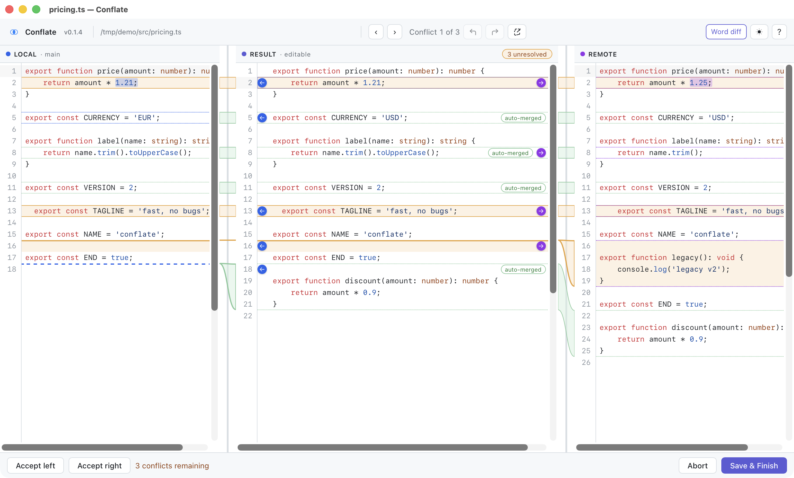

# Conflate

[](../../releases)
[](LICENSE)
-lightgrey?style=flat-square)

**A lightweight, modern desktop app for resolving Git merge conflicts.** A 3-pane
(local / result / remote) merge view, one-click hunk resolution, and
auto-merge of everything that doesn't truly conflict.



## Why Conflate

- **3-way view** — local, result and remote side by side, with connectors
  showing where each change lands.
- **Click or arrow your way through** — accept local, remote or both per hunk,
  jump between conflicts with the keyboard.
- **Auto-merge that stays out of your way** — one-sided and identical changes
  are applied for you; only genuinely overlapping edits are left to resolve.
- **Word-level diffs** — see exactly what changed inside a line.
- **Light and dark** — follows your system theme, with a manual override.
- **Plugs into `git mergetool`** — and therefore into
  [lazygit](https://github.com/jesseduffield/lazygit), which shells out to it.
- **Stays up to date** — checks GitHub releases and offers a one-click update.

<table>
  <tr>
    <td></td>
    <td></td>
  </tr>
  <tr>
    <td>Dark theme</td>
    <td>Light theme</td>
  </tr>
</table>

## Install

### Download a release

Grab the latest `.dmg` from the [Releases](../../releases) page, open it, and
drag `Conflate.app` into `/Applications`.

**Releases are unsigned and not notarized** (no Apple Developer account
code-signing in this project). macOS Gatekeeper will refuse to open an
unsigned, unnotarized app downloaded from the internet with a "Conflate is
damaged / can't be opened" message. Clear the quarantine flag after
installing:

```bash
xattr -d com.apple.quarantine /Applications/Conflate.app
```

Then open it normally.

Git needs to run Conflate from the command line, so after installing, either
point your mergetool config straight at the binary inside the app bundle (see
[Set up as your git mergetool](#set-up-as-your-git-mergetool)) or put it on
your `$PATH` as `conflate`:

```bash
# Any directory on your $PATH works; /usr/local/bin may need sudo (or
# `sudo mkdir -p /usr/local/bin` first on a fresh Apple Silicon Mac).
ln -s /Applications/Conflate.app/Contents/MacOS/conflate /usr/local/bin/conflate
```

### Build from source

See [Build from source](#build-from-source) below.

## Set up as your git mergetool

Conflate is a CLI binary invokable with git's own mergetool substitution
convention:

```
conflate <BASE> <LOCAL> <REMOTE> <MERGED>
```

Add it to `~/.gitconfig`:

```ini
# ~/.gitconfig
[mergetool "conflate"]
    cmd = conflate "$BASE" "$LOCAL" "$REMOTE" "$MERGED"
    trustExitCode = true
[merge]
    tool = conflate
[mergetool]
    keepBackup = false
```

`mergetool.keepBackup = false` stops git from keeping a `<file>.orig` copy of
the conflicted file after every successful merge (git's own default is to
keep it). Conflate also deletes its own `$BASE`/`$LOCAL`/`$REMOTE` temp
files as soon as it reads them, whether you save or abort — but only when
they're actually named like git's own mergetool temp files
(`<name>_BASE_<pid>`/`_LOCAL_<pid>`/`_REMOTE_<pid>`); a plain path handed to
`conflate` directly (e.g. for manual testing) is never touched. With
`keepBackup` set, nothing should linger in your working tree after a normal
`git mergetool` run.

The CLI binary needs to be on your `$PATH` as `conflate`:

- **Installed from the `.dmg`:** the binary is
  `/Applications/Conflate.app/Contents/MacOS/conflate`. Symlink it onto your
  `$PATH` (see [Download a release](#download-a-release)), or skip `$PATH`
  entirely and use the full path in `cmd`:
  `cmd = /Applications/Conflate.app/Contents/MacOS/conflate "$BASE" "$LOCAL" "$REMOTE" "$MERGED"`.
- **Built from source:** the binary is `src-tauri/target/release/conflate`;
  symlink it onto your `$PATH`, e.g.
  `ln -s "$(pwd)/src-tauri/target/release/conflate" /usr/local/bin/conflate`.

Then, in any git repo with a conflict:

```bash
git mergetool
```

### lazygit

lazygit shells out to `git mergetool`, so once `mergetool.conflate` is
configured above (and set as `merge.tool`), lazygit just works — no
lazygit-specific configuration is needed. Trigger it from lazygit's Files
panel on a conflicted file (the default binding is `M` for "resolve merge
conflict with an external tool").

<details>
<summary><b>Exit codes</b></summary>

- `0` — saved: the `merged` path was written via **Save & Finish**. Usually
  that means every conflict was resolved, but it also covers a forced save
  with unresolved conflicts still outstanding: Conflate asks for confirmation
  first ("Save anyway"), and if you confirm, it writes the result as it
  currently stands and still exits `0`, so git will treat the file as
  resolved.
- `1` — aborted, nothing written (`trustExitCode = true` tells git to leave
  the conflict in place). This is the exit code for the **Abort** button
  *and* for every other way of leaving without saving: closing the window,
  `⌘W`, or `⌘Q` / Conflate → Quit.
- `2` — fatal error before any window opens: bad arguments, a missing or
  unreadable `local`/`remote`, or an input that is not UTF-8 text (e.g. a
  binary file).

</details>

## Keyboard shortcuts

The full binding table (from `src/keymap.ts`, also shown in-app via the `?`
help overlay):

| Action | Shortcut |
|---|---|
| Next conflict | `⌥⌘.` |
| Previous conflict | `⌥⌘,` |
| Accept local | `⌥⌘←` |
| Accept remote | `⌥⌘→` |
| Accept both (local, then remote) | `⌥⌘↓` |
| Save & finish | `⌘S` |
| Abort merge | `⌘W` |
| Toggle word-diff highlighting | `⌥⌘H` |
| Toggle theme | `⌥⌘T` |
| Show keyboard shortcuts | `?` |

All chords match on physical key position (not the character produced), so
they're reliable regardless of what `⌥` remaps `.`/`,` to on your layout.

## What Conflate is not

- **Not a git client.** Conflate resolves the conflict in one file, one
  invocation at a time, and exits. It does not browse repositories, show
  history, stage files, or run git commands itself — [lazygit](https://github.com/jesseduffield/lazygit)
  (or your git client of choice) still owns everything else. Conflate is
  invoked *by* git (via `git mergetool`), not the other way around.
- **Not stateful.** There is no project memory or saved conflict history
  beyond a few UI preferences (theme override, window size).
- **Not a multi-file merge tool.** Each invocation handles exactly one
  `<base> <local> <remote> <merged>` quartet, matching git's own mergetool
  substitution convention.

## Platform support

**macOS only (Apple Silicon) for now.** This is the only platform Conflate is built for,
tested on, and ships releases for. The dependency set has nothing
macOS-specific in it, so it likely builds and runs on Linux/Windows too, but
that is currently untested and unsupported.

## Known limitations

- **Text files only.** Inputs must be UTF-8 text; binary files (images,
  archives, ...) are rejected with exit code `2` before a window opens. Use
  git's own tooling (`git checkout --ours/--theirs`) for those.
- **Line endings.** The merge itself works on LF line endings, so a file
  whose only difference between sides is CRLF vs LF never shows a false
  conflict. On save, Conflate writes the result back with the *dominant*
  line ending of the `local` (ours) file — CRLF if more than half of its
  line breaks are CRLF, otherwise LF (falling back to `remote` if `local`
  has no line breaks at all). A file that is consistently CRLF or
  consistently LF therefore keeps its line endings exactly. A file with
  **mixed** line endings comes out uniformly in its dominant ending: the
  minority lines will show up as changed in `git diff`.
- **A lone carriage return** (`\r` not followed by `\n`, e.g. in old
  classic-Mac files) is treated as ordinary line content, never as a line
  break, and is preserved in the vast majority of cases. The one known
  exception: a lone `\r` sitting directly before a CRLF line break (i.e.
  `\r\r\n`) can be dropped, since CRLF normalization isn't fully idempotent
  on that specific byte sequence. This is a rare, pre-existing edge case,
  not something to design around for ordinary files.

## Build from source

Requirements:

- [Rust](https://rustup.rs) (stable toolchain)
- [Node.js](https://nodejs.org) 22+
- macOS, with the Tauri 2 [macOS prerequisites](https://tauri.app/start/prerequisites/)

```bash
git clone https://github.com/dnwjn/conflate.git
cd conflate
pnpm install
pnpm run tauri build
```

This produces `Conflate.app` and `Conflate_<version>_aarch64.dmg` in
`src-tauri/target/release/bundle/macos/` and `.../bundle/dmg/` respectively.

For local development (hot-reloading dev window), Conflate needs the same
four file arguments git would pass it — see
[CONTRIBUTING.md](CONTRIBUTING.md#local-dev-setup) for the exact command
(with a bare `pnpm run tauri dev`, the app exits `2` with a usage error).

See [CONTRIBUTING.md](CONTRIBUTING.md) for the full dev workflow and test
suites.

## Design

The auto-merge algorithm is a standard base-anchored 3-way merge (same
family as `git merge-file`/`diff3`): hunks where only one side diverges from
base are auto-applied, hunks where both sides make the identical change are
auto-applied, and only genuinely overlapping, differing edits are left for
you to resolve by hand.

## License

Conflate is licensed under the [GNU General Public License v3.0 or later](LICENSE).
